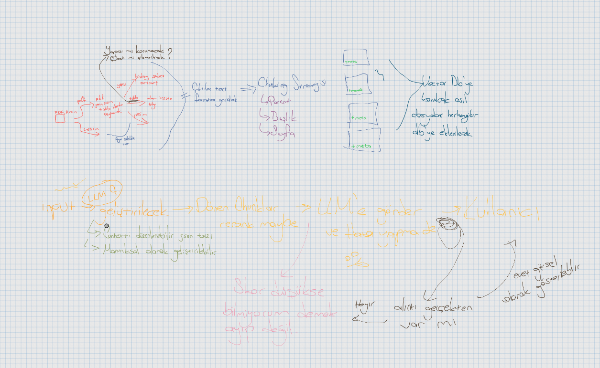
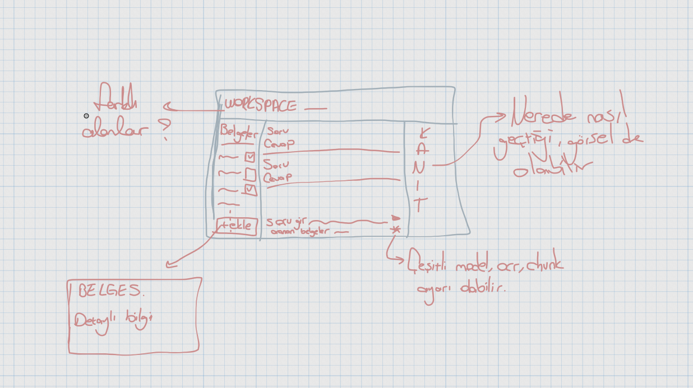

# DEVLOG

Bu günlüğü her çalışma oturumunun sonunda tuttum. Sayıları, hataları ve commit hash'lerini o günkü haliyle bıraktım, sonradan düzeltmedim. Bazı kararlarım sonraki oturumlarda değişti. Değişikliği hangi oturumda yaptıysam orada yazdım, eski kararı da silmedim; neyi neden değiştirdiğim görünsün istedim.

## Zaman

| Oturum | Tarih | İş | Süre |
|---|---|---|---|
| 1 | 13–14.10 | Case analizi, eskizler, frontend iskeleti | ~2,5 sa |
| 2–3 | 14–15.10 | Backend, yükleme, metin çıkarma ve OCR, parçalama, değerlendirme seti, arayüz | ~7 sa |
| 4–7 | 17.10 | Embedding, arama, cevap ve alıntı doğrulama, pytest, model seçimi, sohbet arayüzü | ~8,5 sa |
| 8 | 18.10 | Arama denemeleri, README, belge yönetimi, OCR, güvenlik, hız | ~7 sa |
| 9 | 19–20.10 | Demo, hata mesajı, README kararları, Docker, belgeler | ~6,5 sa |
| **Toplam** | | | **~32 sa** |

Süreleri sohbet kayıtlarının saatlerinden çıkardım; eskiz çizmek ve videoyu kurgulamak dahil değil.

---

## 2026-10-14 · Oturum 1 (bulut): case analizi, eskizler, frontend iskeleti

### Eskizler

Mimari eskizi (v1) ve arayüz eskizi (v0):

Eskizi çizerken baştan bir soruya takıldım: sistem bilmediği bir şey sorulduğunda ne yapmalı? Belgeyle çalışan bir asistanın en büyük riski uydurmak. Bu yüzden ilk ilkeyi "bilmiyorum demek ayıp değil" diye koydum: arama ilgili bir şey bulamazsa ya da modelin alıntısı belgede çıkmazsa sistem cevap vermeyecek. Akışın geri kalanını bu ilkeye göre kurdum: belgeyi oku, parçala, ara, cevabı kaynağıyla üret, kaynağı kontrol et. Tablolar ve çalışma alanları eskizde açık soru olarak kaldı; ikisine de gerçek belgelerle karşılaşınca karar vermek üzere bıraktım.

Eskizden çıkan açık sorular:
- Tablolar: yapısı mı korunacak, özeti mi çıkarılacak?
- Farklı çalışma alanları (workspace) gerekli mi?

İlke: "Bilmiyorum demek ayıp değil." Skor düşükse ya da alıntı belgede doğrulanamazsa cevap "belgelerde yok".

### Kararlar

- Teknik sorular şirkete sorulmadı; kararlar README'deki "Varsayımlar ve kararlar" bölümünde.
- Sohbet geçmişi sınırlı (son 3–4 tur); takip soruları aramadan önce yeniden yazılır.
- Arama varsayılan olarak tüm belgelerde; arayüzden seçilen belgelerle daraltılabilir.
- Model: lokal (Ollama, Qwen2.5 7B) varsayılan, API isteğe bağlı. Embedding, OCR, reranker lokal.
- MVP'de tek çalışma alanı.
- Frontend: React + TypeScript (Vite).

**Sonradan değişenler:** Varsayılan model 7B değil 14B oldu (Oturum 6). API seçeneğini hiç eklemedim; her şey yerel kaldı. Reranker'ı denedim, eklemedim (Oturum 8). Sohbet geçmişini yapmadım; her soru bağımsız cevaplanıyor.

### Yapılanlar

- `frontend/`: Vite react-ts şablonu, demo içerik temizlendi.

### Commit'ler

- `c079c72` Add empty React + TypeScript app with Vite

---

## 2026-10-14/15 · Oturum 2 (lokal): backend iskeleti, belge yükleme

### Kararlar

- Backend klasörü `app/`.
- Bağımlılık yönetimi: uv + `pyproject.toml` + `uv.lock`. Gerekçe: tekrarlanabilir kurulum; ilerideki OCR/embedding paketlerinin bağımlılık zinciri uzun. Alternatif `requirements.txt`, gerekirse `uv export` ile üretilebilir.
- Python 3.11.
- Sürümler `==` ile sabit (Python) ve `^` olmadan sabit (`package.json`, `.npmrc` içinde `save-exact=true`). Gerekçe: güncellemeyle bozulmasın. Alt bağımlılıklar lock dosyalarında sabit.
- Veritabanı: SQLite asıl veri kaynağı, vektör DB ileride sadece indeks olacak (eskiz v2: "asıl dosyalar herhangi bir db'ye eklenecek").
- Dosyalar diskte (`data/uploads/`), SQLite'ta sadece bilgileri ve yolu. Alternatif: SQLite içinde BLOB; DB şişeceği için seçilmedi.
- DB erişimi: SQLModel. Alternatifler: SQLAlchemy (daha çok kod), `sqlite3` (ham SQL).
- Frontend'e önce sadece belge ekleme ve listeleme ekranı; tasarım sonra.

### Yapılanlar

- `GET /health`
- `document` tablosu: id, dosya adı, tür, boyut, yol, durum, yüklenme zamanı.
- `POST /documents`: sadece PDF/JPG/PNG; diskte rastgele adla saklanır. Başka tür → 415.
- `GET /documents`: en yeni başta.
- Arayüz: "+ Ekle" butonu, belge listesi (ad, tür, boyut, tarih), hata mesajı. Vite proxy ile backend'e bağlı.
- `GET /documents/{id}/file`: dosyayı tarayıcıda açar (inline). Arayüzde seçilen belge önizleniyor: PDF iframe'de, resim `` ile.

### Test

- PDF yükleme → kayıt döndü, dosya diskte.
- `.txt` yükleme → 415, "Sadece PDF, JPG ve PNG desteklenir."
- Arayüzden PNG yükleme → listede; sayfa yenilenince de duruyor.

### Notlar / bilinen eksikler

- Tür kontrolü tarayıcının bildirdiği türe bakıyor, dosya içeriğine bakmıyor.
- Boyut sınırı yok.
- `GET /documents` cevabında diskteki yol da dönüyor.
- İlk commit yanlış e-posta ile atılmıştı; yazar düzeltilip force push yapıldı (`8b2a296` → `c079c72`).

### Commit'ler

- `2805999` Add empty FastAPI app with /health endpoint
- `5497e10` Add SQLite database and Document model
- `1ca47eb` Add document upload and list endpoints
- `3a5ca3a` Add document upload screen and pin frontend versions
- `6ed8703` Add document file preview endpoint
- `2b477cd` Add document preview to upload screen

---

## 2026-10-15 · Oturum 2 (devam): metin çıkarma ve OCR

### Kararlar

- Çıkarım için hazır kütüphane yerine kendi pipeline: PDF metin katmanı → pypdfium2, resim → OCR, tablolar → ileride pdfplumber.
  - Unstructured değerlendirildi, seçilmedi. Artısı: hazır parçalama (başlık/paragraf/tablo), `chunk_by_title`, zaman kazancı. Eksisi: tablo ve yerleşim için `hi_res` gerekiyor (PyTorch + YOLOX + tablo modeli, birkaç GB, CPU'da yavaş); `fast` modu pypdfium2'nin yaptığını yapıyor; OCR için yine Tesseract'ı çağırıyor, yani OCR kalitesi değişmiyor; ara adımlar görünmediği için "Cevabın izi" ve alıntı doğrulamada hata ayıklamak zor.
  - Docling değerlendirildi: OCRTurk'te Türkçe karakter skoru (TCS) 0.71, yedi model içinde düşük.
- PDF metin katmanı: pypdfium2 (Apache/BSD). PyMuPDF AGPL olduğu için seçilmedi.
- OCR: önce RapidOCR denendi, Türkçe ı/İ sorunu yüzünden Tesseract'a (`tur+eng`) geçildi. Ayrıntı aşağıda.
- Tesseract sistem programı, pip ile kurulmuyor. Kodda sabit yol yok; PATH'te olmalı. Değerlendirici için ileride Docker (`apt-get install tesseract-ocr tesseract-ocr-tur`) + README'de OS bazlı kurulum + açılışta Tesseract/`tur` kontrolü.
- Fine-tune (PaddleOCR Latin modelini Türkçe sentetik veriyle) değerlendirildi, yapılmadı: tahmini 10–15 saat (veri üretimi, Windows'ta PaddlePaddle kurulumu, eğitim, İngilizceyi unutma kontrolü, ONNX'e çevirme); 25–35 saatlik bütçeye sığmaz. "Daha fazla zaman olsaydı" listesinde.
- OCR'dan sonra arama/eşleştirmede Türkçe harf sadeleştirme (ı→i, ş→s…) yedek önlem olarak eklenecek; gösterilen ve LLM'e giden metin değişmeyecek.

### RapidOCR denemesi (başarısız)

- RapidOCR 3.10.0 + onnxruntime: pip ile kuruluyor, sistem bağımlılığı yok; seçme sebebi buydu.
- Varsayılan model Çince; Latin modeline geçildi (`LangRec.LATIN`, PP-OCRv5). Latin modelinin sadece `mobile` sürümü var, belirtilmeyince "Invalid OCR configuration" hatası.
- Sonuç: Ş, Ç, Ö, Ü, ğ doğru; **ı ve İ hiç yok** (ı→i, İ→i/I). Test resminde: "Işık ılık, İstanbul" → "Işık ilik, istanbul"; "İĞNE" → "IGNE". PP-OCRv4 Latin daha kötü ("I$IK", "iGNE"). PDF sayfasında ayrıca bir satır atlandı.
- Bizim hatamız mı diye bakıldı:
  - Karakter sözlüğü modelin içinden okunuyor; ı ve İ 502 karakter içinde var.
  - Giriş yüksekliği 48, PP-OCRv5 ile uyumlu.
  - Ham çıktı: "İzmir"in İ'si için `i` olasılığı 0.90; ı ilk üç tahminde bile yok. Model harfi biliyor ama öğrenmemiş.
  - PaddleOCR GitHub Discussion #16482: Türkçe özel karakterler mevcut sürümde tam desteklenmiyor, 3.3'e planlı.
- "OCRTurk" makalesi (SIGTURK 2026, arXiv 2602.03693) PaddleOCR'ı birinci gösteriyor; ama orada test edilen **PaddleOCR-VL** (0.9B görsel-dil modeli, 40 GB GPU), bizim kullandığımız 7.5 MB'lık PP-OCRv5 Latin mobile değil. Ayrıca Türkçe karakter skorunda (TCS) en iyi HunyuanOCR (0.88), PaddleOCR-VL 0.82.
- PaddleOCR-VL seçilmedi: 4 GB GPU'ya yerel LLM ile birlikte sığmaz, Windows'ta PaddlePaddle kurulumu zor.
- Alternatifler: EasyOCR (pip, ama PyTorch gerekiyor) ve Tesseract. Tek karar verilmesi gerektiği için Tesseract: Türkçe metinle eğitilmiş `tur` modeli, CPU'da çalışıyor (GPU LLM'e kalıyor), olgun, Apache 2.0.
- RapidOCR hiç commit'lenmedi.

### Yapılanlar

- `app/extract.py`:
  - `extract_pdf_text(path)`: pypdfium2 ile metin katmanı, sayfa sayfa liste.
  - `extract_image_text(path)`: `pytesseract.image_to_string(path, lang="tur+eng")`.
- `GET /documents/{id}/text`: PDF → metin katmanı, resim → OCR. Cevap `[{"page": 1, "text": "..."}]`. İstek anında çıkarıyor, kaydetmiyor.
- Tesseract 5.5.3 (UB Mannheim) kuruldu, `tur` + `eng`. winget makinede yoktu, yükleyici elle indirildi.

### Test

- pypdfium2, gerçek PDF'ler: 6 sayfa / 6 sayfa metin geldi, Türkçe karakterler (İ, Ş, ’) doğru. Olmayan id → 404.
- OCR karşılaştırması (aynı resimler):

| Test | RapidOCR (Latin v5) | Tesseract `tur+eng` |
|---|---|---|
| ı/İ test resmi (Arial 40px, 3 satır) | "ilik", "istanbul", "Kirmizi", "IGNE" | Hepsi doğru |
| PDF 1. sayfası, resme çevrilmiş (2× ölçek) | ı/İ hep yanlış, bir satır atlandı | CER %1.6 (2364 karakter); 113 ı ve 7 İ'nin hepsi doğru |
| İngilizce örnek | Doğru | Doğru |
| Süre (1 sayfa, CPU) | ~4.6 s | ~1.1 s |

- CER referansı: aynı sayfanın PDF metin katmanı (boşluklar sadeleştirilerek). RapidOCR için CER tam ölçülmedi; sadece ı/İ hataları sayılınca en az ~%5.
- Tesseract'ın kalan hataları: madde işaretleri `e` / `*` / `»*`; logo harf gibi okunuyor; arada Türkçe harf düşüyor ("Çalışma" → "Galisma", "gerçekleştirilecektir" → "gerceklestirilecektir", "Üniversite" → "Universite"); tek başına duran harfler bağlamsız okunamıyor ("Ğ İ ı ş ü" → "Giis t").
- `/text` endpoint'i resimle: ayrı veri klasöründe ayrı test sunucusu (port 8001), PNG yükle → `/text` doğru metni döndürdü.

### Notlar / bilinen eksikler

- Çıkarılan metin kaydedilmiyor, her istekte yeniden çıkarılıyor; `status` güncellenmiyor.
- Taranmış PDF (metin katmanı boş) henüz OCR'a gönderilmiyor.
- Tablolar henüz yok.
- Tesseract fotoğraf kalitesindeki (eğik, gölgeli) görsellerde zayıf olabilir; ölçülmedi.

### Commit'ler

- `7d17de6` Add PDF text extraction with pypdfium2 and /text endpoint
- `e0fb527` Add image OCR with Tesseract (tur+eng) to /text endpoint

---

## 2026-10-15 · Oturum 2 (devam): taranmış PDF sayfalarına OCR

### Yapılanlar

- `extract_pdf_text`: metin katmanı boş olan sayfa 300 DPI'da resme çevrilip Tesseract'a gönderiliyor. Karar sayfa bazında, böylece karışık PDF'ler (bir kısmı dijital, bir kısmı taranmış) da çalışıyor.
- Önceki bölümdeki "Taranmış PDF henüz OCR'a gönderilmiyor" eksiği bununla kapandı.

### Test

- `scanned.pdf`: 6 sayfa, sadece resim (200 DPI), metin katmanı yok. Bütün sayfalar OCR'dan geçti.
- `mixed.pdf`: 1. sayfa metin katmanlı, 2. sayfa taranmış. 1. sayfa metin katmanından, 2. sayfa OCR'dan geldi.

### Notlar / bilinen eksikler

- `extract_pdf_text` zayıf noktaları:
  - "Taranmış mı" kontrolü sadece metin katmanının tamamen boş olmasına bakıyor. Taranmış sayfaya dijital sayfa numarası ya da damga eklenmişse sayfa dijital sanılıyor, OCR yapılmıyor ve içerik kayboluyor. Olası çözüm: karakter sayısı eşiği ya da sayfadaki resmin kapladığı alan.
  - Metin katmanı olan sayfadaki gömülü resimlerin (örneğin tablo ekran görüntüsü) içindeki yazı okunmuyor.
  - OCR hata verirse `page.close()` atlanıyor. PDF `finally` içinde kapandığı için büyük sorun değil, ama tam temiz değil.
  - OCR sıralı ve istek içinde çalışıyor: taranmış sayfa başına ~2 s, 50 sayfa ~100 s. Paralel işleme ya da arka plan işi gerekebilir.
  - 300 DPI ölçümle kanıtlanmadı. 150/200/300 karşılaştırmasını tablolu sayfanın okunma sırası bozdu (200 DPI'da 2. sayfa CER %57). Karar Tesseract'ın önerisine ve yaygın pratiğe dayanıyor.
  - Resim dosyalarında (PNG/JPG) ölçek kontrolü yok, olduğu gibi Tesseract'a gidiyor. Fotoğraflarda harfler çok küçük ya da çok büyük olabilir.

### Commit'ler

- `9ef109c` OCR scanned PDF pages with empty text layer

---

## 2026-10-15 · Oturum 2 (devam): PDF tabloları (pdfplumber) ve taranmış sayfa eşiği

### Kararlar

- Tablolar için pdfplumber 0.11.10 (MIT). Bağımlılıkları pdfminer.six (MIT), pypdfium2, Pillow; ağır model yok.
- Tablolar Markdown'a çevrilip sayfadaki yerlerine konuyor. Gerekçe: LLM satır/sütun ilişkisini görebilsin (grup ↔ içerik).
- pdfplumber sadece metin katmanlı sayfalarda. Taranmış sayfalar yine Tesseract'a gidiyor; taranmış tablolar için çözüm yok (bilinen sınır).
- "Taranmış mı" kararı artık karakter eşiğiyle: metin katmanında boşluksuz 50 karakterden az varsa sayfa OCR'a gidiyor. Önceki bölümdeki zayıf noktanın (sayfa numarası/damga OCR'ı engelliyor) çözümü. 50 ölçümle seçilmedi; yanlışlıkla OCR'a giden kısa sayfa sadece yavaş okunur, içerik kaybolmaz.

### Yapılanlar

- `extract_page_with_tables(page)`: tabloları bulur (`find_tables`), yukarıdan aşağı sıralar; tablo içindeki karakterleri düz metinden çıkarır (tekrar olmasın); sayfayı tablo sınırlarından dilimler: tablonun üstündeki ve yanındaki metin → tablo → sonraki metin.
- `table_to_markdown(rows)`: tamamen boş sütunları atar, hücre içi satır sonlarını boşluğa çevirir, `|` karakterini kaçırır.
- `MIN_TEXT_CHARS = 50`.

### Test

- İlan PDF'i: 2–6. sayfalarda tablo bulundu, 1. sayfada yok. 3. ve 6. sayfada grup ↔ içerik eşleşmesi korunuyor, madde işaretleri bozulmuyor (OCR'daki Vaka 9 sorunları metin katmanlı PDF'te yok).
- Tablo dışı metin pypdfium2 ile aynı (sadece sayfa numarasının yeri farklı); Türkçe karakter farkı yok.
- Kelime kaybı kontrolü (pypdfium2 çıktısıyla, sıradan bağımsız): ilan ve kişisel belgede her sayfada 0 kayıp, 0 fazla kelime.
- Süre: 6 sayfa ~0.6 s.
- Karışık PDF'te OCR yolu çalışmaya devam ediyor.
- Eşik testi: taranmış 2. sayfanın metin katmanına "- 2 -" eklendi (3 karakter). Eski kod OCR'ı atlayıp sadece "- 2 -" döndürürdü; yeni kod OCR'a gönderdi, 1930 karakter (2.2 s). Gerçek PDF'lerde sayfa başına 1184–4626 boşluksuz karakter; hiçbiri OCR'a gitmedi.

### Hatalar ve düzeltmeler

- Kişisel belgenin 5. sayfasında yan yana/üst üste tablolar: kırpma `negative height` hatası verdi. Tablolar (üst, sol) sırasına göre sıralandı, kırpma alt sınırı geriye gitmeyecek şekilde düzeltildi.
- Aynı sayfada tablonun yanındaki 10 kelime hiçbir dilime düşmüyordu. Dilim tablonun üstüne kadar değil altına kadar alındı; yanındaki metin tablodan önce geliyor.

### Notlar / bilinen eksikler

- Birleştirilmiş hücreler: değer sadece ilk satırda (ilan 5. sayfa: 135 üç grubun ortak değeri, sadece ilkinde).
- Birden çok sütuna yayılan başlık boş hücre bırakıyor (ilan 2. sayfa).
- Çizgisiz tablolar bulunmuyor (varsayılan strateji çizgilere bakıyor). Kişisel belgenin 1–4. sayfalarında tablo bulunmadı; çizgisiz olabilir, doğrulanmadı.
- Parçalama adımında bir tablo bölünmemeli; büyükse satır sınırından bölünüp her parçaya başlık satırı eklenmeli.
- Commit mesajında karakter eşiği geçmiyor; ikisi aynı commit'te.

### Commit'ler

- `4ac52cc` Extract PDF tables with pdfplumber

---

## 2026-10-15 · Oturum 2 (devam): metin sayfalarındaki gömülü resimlere OCR

### Kararlar

- Metin katmanlı sayfadaki gömülü resimler de OCR'lanıyor. Önceki bölümlerdeki "gömülü resimlerin içindeki yazı okunmuyor" zayıf noktasının çözümü.
- OCR'a resmin kendisi değil, sayfanın 300 DPI render'ından resmin kapladığı bölge gidiyor. Sayfa en fazla bir kez render ediliyor.
- Gömülü resimlerde kelime güven eşiği 60 (`MIN_IMAGE_WORD_CONF`). Ölçüm: ilan banner'ında kurum adının iki kelimesi 95 ve 93, çöp `¥` 21; kişisel belgedeki tek kelimelik çöp okuma 44. Eşik ikisini de atıyor, gerçek kelimeleri tutuyor.
- Üstünde 50 ya da daha fazla karakter metin katmanı olan resim atlanıyor (aranabilir tarama). Metin zaten katmandan geliyor, iki kez okunmasın.
- Kaynak çözünürlüğünün kısa kenarı 20 pikselden küçük resim atlanıyor (`MIN_IMAGE_PX`). Render resmi büyütür ama bilgi eklemez; bu boyutta okunabilir yazı olamaz. 50 piksel düşünüldü, seçilmedi: 30–50 piksellik tek satırlık damga/etiket okunabilir olabilir.

### Yapılanlar

- `extract_page_with_tables` → `extract_text_page(page, pdfium_page)`: tablolar ve resimler aynı "blok" mantığıyla (konum + metin) sıralanıp yerlerine konuyor; blokların içindeki metin katmanı karakterleri düz metinden çıkarılıyor.
- `extract_embedded_images(page, pdfium_page)`: resim bölgelerini kırpıp OCR'lıyor, `(bbox, metin)` döndürüyor.
- `extract_confident_text(image)`: `image_to_data` ile okuyup güveni düşük kelimeleri atıyor, satırları koruyor.

### Test

- Üretilmiş PDF: üstte metin, ortada Vaka 4'ün ı/İ resmi, altta metin. Resimdeki 3 satır hatasız okundu, iki metnin arasına doğru sırayla yerleşti.
- Aranabilir tarama (Tesseract'ın ürettiği PDF: sayfa resmi + görünmez metin): resim OCR'lanmadı, çıktı önceki commit'le aynı (2381 karakter).
- İlan: her sayfanın başına banner'dan kurum adı eklendi, `¥` filtrelendi, kaybolan kelime yok.
- Kişisel belge (sadece sayılar): 18 resmin hiçbirinden metin çıkmadı, çıktı önceki commit'le aynı. 20 piksel eşiğinden sonra OCR çağrısı 18 → 12 (1×1 piksellik 6 resim atlandı).
- Süre dağılımı (kişisel belge): 6 sayfa render ~0.2 s; OCR 301×301 logolar 1.07 s, 1×1 resimler 1.20 s, 49×49 resimler 0.94 s, hiçbiri metin üretmiyor. Asıl maliyet OCR çağrıları.

### Notlar / bilinen eksikler

- Hız: ilan 0.6 s → ~2.3 s. Süre ölçümleri gürültülü (aynı kodla 2.3 s ve 3.2 s görüldü); güvenilir ölçü OCR çağrısı sayısı.
- Büyük ama yazısız resimler (301×301 logo, 49×49 resim) boyutla elenmiyor; OCR'lanıp güven filtresinde atılıyor.
- Logo metni (kurum adı) her sayfaya ekleniyor; parçalamada her parçada tekrar edecek.
- Taranmış sayfalarda (OCR yolu) güven filtresi yok; sadece gömülü resimlerde var.
- Sistemin genel yapısı ve metin çıkarma akışı diyagramları tasarım tuvalinin "Eskizler (DEVLOG)" sayfasına eklendi.

### Commit'ler

- `699a7b1` OCR embedded images on PDF text pages

---

## 2026-10-15 · Oturum 2 (devam): çıkarılan metnin kaydı ve belge durumu

### Kararlar

- Metin yüklemede bir kez çıkarılıp kaydediliyor. Önceden `/text` her istekte yeniden çıkarıyordu; taranmış 6 sayfa ~13 s sürüyordu.
- Sayfalar ayrı tabloda (`Page`: belge, sayfa no, metin). Gerekçe: parçalama ve kaynak gösterme sayfa numarasıyla çalışacak. `create_all` mevcut tabloya kolon eklemediği için yeni tablo, mevcut veritabanı bozulmadan açılıyor.
- Çıkarma FastAPI `BackgroundTasks` ile yanıttan sonra çalışıyor; yükleme hemen dönüyor. Kuyruk sistemi (Celery vb.) eklenmedi, MVP için gereksiz.
- Durumlar: `uploaded` → `processing` → `ready` / `failed`.
- Belgeler bir kilitle tek tek işleniyor: pdfium thread-safe değil. Sayfaları paralel OCR'lamak mümkün (Tesseract ayrı süreç), ölçümle ayrı adımda.
- Açılışta `uploaded`/`processing` durumundaki belgeler yeniden işleniyor (`process_pending`). İki durumu kapsıyor: bu adımdan önce yüklenmiş belgeler ve işlenirken sunucunun kapanması (`--reload` dahil). Açılışı bekletmemek için ayrı thread'de.
- `failed` belge için yeniden deneme yolu eklenmedi.

### Yapılanlar

- `app/processing.py`: `process_document(id)` (çıkar, eski sayfaları sil, kaydet, durumu güncelle; hata olursa logla ve `failed`), `process_pending()`.
- Yükleme ucu işi arka plana ekliyor.
- `/documents/{id}/text`: kayıtlı sayfaları döndürüyor; belge yoksa 404, hazır değilse 409 ("Belgenin metni hazır değil (durum: …)").

### Test

İzole klasörde, `TestClient` ile:

- Eski şemalı veritabanı (sadece `document` tablosu, `uploaded` ve `processing` durumunda 2 belge): açılışta `page` tablosu eklendi, ikisi de 13.4 s'de `ready`. Taranmış PDF 6 sayfa (2397, 1925, 2782, 2072, 1869, 1898 karakter), PNG 1 sayfa, ı/İ doğru.
- Eşzamanlı iki yükleme: ikisi de `uploaded` döndü, sonra `ready`. Sayfa sayıları doğru.
- Tesseract PATH'te yokken PNG: `failed`, `/text` → 409, `page` tablosuna satır yazılmadı.
- Olmayan belge: 404.

### Notlar / bilinen eksikler

- Sunucunun Tesseract'ı bulabilmesi gerekiyor (PATH); bulamazsa belgeler `failed` oluyor.
- Belgeler sırayla işlendiği için arka arkaya yüklenen büyük taranmış PDF'ler sırada bekliyor.
- Eski sürümle çalışan sunucuda yüklenmiş belgeler yeni sürüm açılınca işlenecek.

### Commit'ler

- `2eee56a` Store extracted page text and track document status

---

## 2026-10-15 · Oturum 2 (devam): arayüzde durum ve çıkarılan metin

### Kararlar

- Listede her belgenin durumu Türkçe etiketle: Sırada, İşleniyor, Hazır, Metin çıkarılamadı.
- İşlenen belge varken liste 2 saniyede bir yenileniyor; hepsi bitince yenileme duruyor. WebSocket/SSE eklenmedi, MVP için gereksiz.
- Seçili belgenin önizlemesinin altında "Çıkarılan metin" alanı: sayfa sayfa, karakter sayısıyla. Gerekçe: çıkarma kalitesini (OCR hataları, tablo Markdown'ı) arayüzden görmek; demo videosunda da gösterilecek.
- Seçili belge kimlikle tutuluyor; durum yenilenince seçili belgenin durumu da güncelleniyor ve hazır olunca metin kendiliğinden geliyor.

### Yapılanlar

- `api.ts`: `getDocumentText(id)`.
- `App.tsx`: durum etiketleri, yenileme, metin alanı. Bekleyen belgede "Metin çıkarılıyor…", başarısızda "Metin çıkarılamadı. Sunucu loguna bakın.", boş sayfada "(Bu sayfadan metin çıkmadı.)".

### Test

Ayrı portta, izole veri klasörüyle çalışan backend + frontend, uygulama içi tarayıcı:

- Taranmış PDF yüklenip hemen seçildi: "Metin çıkarılıyor…" → ~8 s sonra yenileme `Hazır`'ı yakaladı, 6 sayfa karakter sayılarıyla göründü (kayıt adımındaki testle aynı sayılar).
- Bozuk PDF: listede "Metin çıkarılamadı", seçilince uyarı mesajı. Sunucu logunda `PdfiumError: Data format error`.
- `tsc -b` ve `eslint` temiz.

### Notlar / bilinen eksikler

- Belge hazır olduktan sonra metin gelene kadar alan kısa bir an boş kalıyor (yükleniyor mesajı yok).
- Uzun belgelerde tüm sayfalar tek seferde çiziliyor; sayfalama yok.
- Arayüz stilsiz (varsayılan HTML).
- Test sırasında Vite sunucusu bir kez kapandı: VS Code'daki Console Ninja eklentisinin build hook'u WebSocket hatası verdi. Projeyle ilgisi yok; yeniden başlatınca düzeldi.

### Commit'ler

- `079f082` Show document status and extracted text in UI

---

## 2026-10-15 · Oturum 2 (devam): parçalama (chunking)

Belgeyi paragraflara bölmeyi planlamıştım. Kodu yazmadan önce gerçek sayfaları ölçünce bu planın işe yaramayacağını gördüm: metin katmanlı PDF'lerde paragraf ayrımı neredeyse yoktu, OCR'da ise bloklar çok küçüktü. Birimi cümle yaptım ve tabloları bölmemeye karar verdim.

### Ölçüm (kod yazmadan önce)

Gerçek sayfa metinlerinde blok boyutları (kişisel belge için sadece sayılar):

| Belge | Sayfa karakteri | Boş satırla ayrılan bloklar (medyan / en büyük) | Tablolar (adet, medyan / en büyük) | Cümle (medyan / en büyük) |
|---|---|---|---|---|
| İlan (metin katmanı) | 1909–2730 | 45 / 2364 | 5 adet, 1059 / 1843 | 126 / 942 |
| Kişisel belge (metin katmanı) | 1383–5784 | 1137 / 3947 | 5 adet, 532 / 3422 | 90 / 998 |
| Taranmış PDF (OCR) | 1869–2782 | 63 / 629 | yok | 65 / 629 |
| PNG (OCR) | 531 | 43 / 275 | yok | 53 / 168 |

- Metin katmanında paragraf ayrımı yok (6 sayfada 16 ve 7 boş satır), bloklar çoğunlukla sayfanın tamamı. OCR'da tersi: bloklar çok küçük. "Paragraf = boş satır" planı bu yüzden bırakıldı, birim cümle oldu.
- 10 tablonun 2'si 1800 karakteri aşıyor → satır sınırından bölme gerçek bir ihtiyaç. En uzun tablo satırı 1177 karakter.
- En uzun cümle 998 karakter → cümle ortasından kesmek gerekmiyor.

### İncelenen projeler

- pdf-qa-assistant: karakterle 800 / 150 örtüşme; parçalar sayfa sınırını geçmiyor (bedeli README'de yazılı); "karakterle başla, ölçüm setine karar verdir".
- turkish_rag_chatbot: LlamaIndex anlamsal bölme, 256–1024 token, 64 örtüşme.
- TR-Docuquery: maddeye göre ("MADDE 6 – FESİH"); uzun maddeye başlık tekrarı; parçada okuma yöntemi (metin katmanı/OCR).
- PaperQA2: 5000 karakter, 250 örtüşme; tablo/resim parça sınırında bölünmüyor.
- RAGFlow: belge türüne göre şablon; General 512 token.

### Kararlar

- Yapıya göre bölme: cümle birimi; madde işaretli satır (`•`, `-`, `1.`) ve tamamı büyük harfli satır (başlık) yeni satırdan başlar. Anlamsal bölme seçilmedi: işleme sırasında model gerekiyor, hata ayıklaması zor, yapılı belgede üstünlüğü belirsiz (incelenen projelerde ölçüm yok). Sabit boyut seçilmedi: tablo ve cümleyi bölüyor.
- Boyut karakterle: hedef 1100, en fazla 1800. Gerekçe: reranker (ör. bge-reranker-v2-m3) ~512 token, Türkçede karakter başına token daha fazla. Ölçülmedi; embedding modeli seçilince token'la ölçülecek, soru setiyle ayarlanacak.
- Parçalar sayfa sınırını geçmiyor: kaynak gösterme ve alıntı kontrolü tek sayfaya bakar. Bedeli: sayfaya taşan paragraf bölünür.
- Örtüşme: bir cümle. Tek cümlelik parçada örtüşme yok (bütün parçayı tekrarlamak olurdu).
- Tablolar: sığıyorsa tek parça, önündeki cümle başlık olarak eklenir. Büyükse satır sınırından bölünür, her parçada başlık satırı (ve tablo başlığı) tekrarlanır.
- Tablonun önünde kalan küçük metin (ör. "EK-1: …") tabloya başlık olur; arkasında kalan küçük metin (ör. sayfa numarası) önceki parçaya eklenir. 200 karakterden kısa parça oluşmuyor.
- Her parçada sayfa, sıra, tür (`text`/`table`), kaynak (`text`/`ocr`, TR-Docuquery'den) ve bölüm.
- Bölüm (`section`): parçanın başladığı yerdeki son başlık; parça başında yoksa içindeki ilk başlık. Ardışık başlık satırları tek başlık. Başlık sonraki sayfalara devreder. Başlık için en az 5 harf (OCR'ın "KE" gibi çöp okumaları için).
- Bağlam satırı (`Belge: … · Sayfa …`) kaydedilmiyor; indeksleme adımında aramaya giden metne eklenecek.
- Önceden işlenmiş ama parçası olmayan belgeler açılışta yeniden işleniyor.

### Değerlendirilen, eklenmeyen: LLM ile parça özeti / "bu parça hangi sorulara cevap verir" (doc2query, HyQE)

- Her parça için LLM birkaç soru (ya da konu özeti) üretir; aramada bunlar da eşleşir. Kullanıcının sorusu belgedeki ifadeden farklı olduğunda aramayı iyileştirebilir.
- Bedeli: işleme sırasında parça başına LLM çağrısı (4 GB GPU'da 7B modelle parça başına birkaç saniye; 6 sayfa ~20 parça ≈ 1 dakika ek). Üretilen sorular uydurma olabilir; sadece aramada kullanılırsa zararı sınırlı, cevaba girmemeli.
- İncelenen projelerin hiçbiri yapmıyor.
- Karar: arama ve kontrol sorulu ölçüm seti hazır olunca, önce/sonra ölçülerek eklenecek.

### Yapılanlar

- `app/chunking.py`: `chunk_page(text, section)` → `(tür, metin, bölüm)` listesi ve sonraki sayfaya devreden bölüm. Cümle bölme Türkçe kısaltmaları (vb., Dr., Prof., …) ve baş harfleri ("A.") cümle sonu saymıyor; sınırı aşan cümle kelime sınırından bölünüyor (ölçülen belgelerde olmadı).
- `Chunk` tablosu: belge, sayfa, sıra, metin, tür, kaynak, bölüm.
- `extract_pdf_text` her sayfa için kaynağı da döndürüyor.
- Parçalama arka plan işinde, çıkarmanın ardından; eski parçalar siliniyor.

### Test

- Gerçek sayfalarda (veritabanı salt okunur):

| Belge | Parça (tablo) | Boyut min / medyan / max | >1800 | Kayıp kelime | Farklı bölüm |
|---|---|---|---|---|---|
| İlan | 19 (6) | 248 / 785 / 1481 | 0 | 0 | 5 |
| Kişisel belge | 27 (8) | 263 / 857 / 1784 | 0 | 0 | 10 |
| Taranmış PDF | 16 (0) | 369 / 966 / 1096 | 0 | 0 | 10 |
| PNG | 1 | 524 | 0 | 0 | 0 |

- İlan: tablolar önündeki cümleyle tek parça; EK-1 tablosu (1843 karakter) başlık tekrarlanarak 2 parçaya bölündü; bölümler (GENEL HUSUSLAR, ADAYLARDA ARANAN ŞARTLAR, ÖDEME VE BAŞVURU SÜRECİ, SINAV SÜRECİ) doğru parçalarda, sayfalar arasında devrediyor.
- İzole uçtan uca (`TestClient`): parçası olmayan eski `ready` belge açılışta yeniden işlendi (2.7 s), 1. sayfa `text`, taranmış 2. sayfa `ocr`; PNG yüklemesi 1 parça, `ocr`; ikinci açılışta yeniden işleme yok.

### Hatalar ve düzeltmeler

- Tablodan sonra kalan sayfa numarası ("5", "6") 1 karakterlik ayrı parça oluyordu; önceki parçaya eklendi.
- "EK-1: …" hem 60 karakterlik ayrı parça hem tablo başlığı olarak iki kez geçiyordu; küçük parça tabloya katıldı.
- Büyük harfli başlıklar önceki cümleye yapışıyordu; başlık satırı ayrı paragraf yapıldı.
- İlk parça başlıktan önce kurum adı satırıyla başladığı için bölümsüz kalıyordu; parça başında bölüm yoksa içindeki ilk başlık kullanıldı.
- OCR'da "KE" çöp okuması başlık sayılıp 4 parçaya bölüm oluyordu; en az 5 harf şartı eklendi.

### Notlar / bilinen eksikler

- Başlık algılama sadece tamamı büyük harfli satırlar. "Sınav Daveti", "Mülakat", "EK-1: …" gibi başlıklar algılanmıyor (EK-1 tablosu "SINAV SÜRECİ" bölümünde görünüyor).
- OCR'da yanlış başlıklar: taranmış tabloların büyük harfli başlık satırları ("SINAV GRUP ADI LİSANS BÖLÜM ADI") bölüm sanılıp sonraki sayfalara taşınıyor; PNG'deki büyük harfli içerik satırı da başlık sayıldı. Bölüm metni değiştirmiyor, sadece ek bilgi.
- OCR madde işaretlerini `e`, `¥`, `*` olarak okuyor; madde algılama OCR'da çalışmıyor.
- Kaynak sayfa bazında: metin katmanlı sayfadaki gömülü resim metni de `text` görünüyor.
- Hiç parçası çıkmayan belge her açılışta yeniden işlenir.
- Logo metni (kurum adı) her sayfanın ilk parçasında.

### Commit'ler

- `ade8636` Split extracted text into chunks

---

## 2026-10-15 · Oturum 2 (devam): genişletilmiş test seti ve metin katmanı düzeltmesi

### Neden

Çıkarma ve parçalama kararları şimdiye kadar aynı 4–5 belgeyle (ilan, kişisel belge, bunlardan üretilmiş PDF'ler, ı/İ resmi) verildi. Farklı belge türlerinde doğrulamak için incelenen projelerin repolarından test belgeleri indirildi.

### Test seti (`testdata/`, git'e girmiyor: `.git/info/exclude`)

Başkalarının dosyaları olduğu için repoya eklenmedi. 19 dosya, 5.4 MB:

| Dosya | Kaynak repo | Tür |
|---|---|---|
| `tr_is_kanunu.pdf` (55 s.) | Erennw/pdf-qa-assistant | Türkçe mevzuat, "MADDE n" yapısı |
| `en_nist_csf.pdf` (32 s.) | Erennw/pdf-qa-assistant | İngilizce rapor, tablolar |
| `tr_sirket_politikasi.pdf`, `tr_fatura.png` | berkecftc/turkish_rag_chatbot | Kısa Türkçe metin PDF'i; Türkçe fatura resmi |
| `tr_basvuru_formu.pdf`, `tr_eksik_veri_avcisi.pdf`, `tr_capraz_belge_hakemi.pdf` | MuhammetDikmetas/TR-Docuquery | Türkçe form/sözleşme tipi belgeler |
| `di_shift-handover-scan.pdf`, `di_shift-handover.png`, `di_untrusted-instruction.pdf`, `di_aster-maintenance.pdf`, `di_recebimento-materiais.pdf`, `di_restricted-planning.pdf` | santosgus3dtech/document-intelligence-rag | Taranmış PDF + aynı içeriğin resmi; talimat gömülü belge (prompt injection); kısa İngilizce/Portekizce belgeler |
| `kotaemon_table.pdf`, `kotaemon_multimodal.pdf`, `kotaemon_7810….jpg` | Cinnamon/kotaemon | Tablo; metin+resim+tablo; JPG |
| `paperqa_paper.pdf` (41 s.), `paperqa_pasa.pdf` (15 s., iki sütun), `paperqa_duplicate_media.pdf` | Future-House/paper-qa | Akademik makaleler; tekrar eden resimler |

Eksik tür: gerçek Türkçe taranmış sayfa / telefon fotoğrafı. Bulunan Türkçe OCR veri seti (emredeveloper/turkish-ocr) sentetik ve çoğu el yazısı; OCRTurk'ün indirilebilirliği doğrulanamadı.

### Bulgu: pdfplumber metni bozuyordu

- `4ac52cc`'den beri metin katmanlı sayfalarda düz metin pdfplumber'dan geliyordu. Dar harf aralıklı PDF'lerde kelimeler birleşiyor ("processestheuserqueryandcanaccess…"), iki sütunlu sayfada sol ve sağ sütunun satırları karışıyordu.
- Etki (pypdfium2'de olup pdfplumber'da olmayan kelime): pasa 5155/8851 (%58), TR-Docuquery formları 109/274 (%40), paper 454/10876. İlan, kişisel belge, İş Kanunu, NIST'te 0–3.
- Neden görülmedi: ilk iki belgede sorun yoktu; kelime kaybı kontrolü sıraya bakmıyordu (kişisel belgede sıra bozuktu, kayıp 0 görünüyordu).
- pdfplumber ayarları denendi: `x_tolerance=1.5` formları ve makaleleri büyük ölçüde düzeltti ama kotaemon_table'ı bozdu (17/34), sütun sorunu kaldı. `use_text_flow` tek başına işe yaramadı.

### Kararlar

- Düz metin pypdfium2'den, PDF'teki sırasıyla (sütunlara uygun). pdfplumber sadece tablo bulmak için.
- Tablo/resim olan sayfada pypdfium2 karakterlerinin kutularına bakılıyor; blok içindekiler atlanıyor, gerisi sırasıyla alınıyor. Tablo ilk karakterinin yerine, resim (karakteri yok) altından başlayan ilk metnin önüne konuyor.
- Tablo hücre sınırları pdfplumber'dan, hücre metni pypdfium2'den (`get_text_bounded`); tablo içinde de kelimeler ayrılıyor.
- Yeni ölçü: kelime çifti örtüşmesi (referanstaki ardışık kelime çiftlerinin çıktıda bulunma oranı). Kelime kaybı sırayı göstermiyor; bundan sonra ikisi birlikte ölçülecek.

### Test

Referans: pypdfium2 tam sayfa metni (eski → yeni):

| Belge | Kayıp kelime | Fazla kelime | Kelime çifti örtüşmesi |
|---|---|---|---|
| paperqa_pasa | 5132 → 2 | 1630 → 50 | %31.0 → %99.9 |
| tr_basvuru_formu | 23 → 0 | 11 → 0 | %68.0 → %100 |
| tr_capraz_belge_hakemi | 43 → 0 | 18 → 0 | %34.5 → %100 |
| tr_eksik_veri_avcisi | 43 → 0 | 17 → 0 | %36.8 → %100 |
| paperqa_paper | 444 → 0 | 481 → 302 | %94.6 → %100 |
| paperqa_duplicate_media | 5 → 0 | 52 → 52 | %86.2 → %99.5 |
| en_nist_csf | 1 → 0 | 132 → 130 | %96.9 → %99.9 |
| kotaemon_table | 0 → 0 | 168 → 168 | %87.9 → %93.9 |
| Kişisel belge | 0 → 0 | 0 → 4 | %84.0 → %99.9 |
| İlan | 0 → 0 | 12 → 12 | %99.5 → %99.8 |
| tr_is_kanunu | 3 → 0 | 3 → 0 | %100 → %100 |

- "Fazla" kelimelerin çoğu gömülü resim OCR'ı (ilanda banner'daki kurum adı, makalelerde şekillerdeki yazılar).
- Süre değişmedi: İş Kanunu 55 sayfa 8.3 → 7.9 s, NIST 32 sayfa 6.6 → 6.7 s.
- Parçalama 19 belgede: kayıp kelime 0.
- İlan ve pasa tabloları gözle kontrol edildi: hücreler doğru, kelimeler ayrı.

### Notlar / bilinen eksikler

- Kişisel belgenin bir sayfasında hücre sınırındaki bir harf iki hücreye düşüyor (2 kez, tek harf): `get_text_bounded` sınıra değen karakteri de alıyor.
- Gömülü resim OCR'ı makalelerdeki şekillerin yazılarını metne ekliyor (paper'da ~300 kelime); gürültülü olabilir.
- Genişletilmiş sette bulunan diğer sorunlar (sıradaki adımlar):
  - Başlık algılama sadece ilanda çalışıyor: NIST'te 67 parçanın bölümü "DETECT" (diyagramdaki kelime), paper'da "T T T T T T 4 — +" (grafikten çöp), İş Kanunu'nda "İKİNCİ BÖLÜM" (asıl başlık alt satırda, madde düzeyi yok).
  - Sahte tablolar: şekillerdeki çizgiler tablo sanılıyor (`|  |` gibi 6 karakterlik "tablolar", NIST kapağı); pasa'da çerçeveli örnek listesi tek sütunlu tablo olarak geliyor.
  - NIST'te tek tablo satırı 1800'ü aşıyor (parça 1940 karakter).

### Commit'ler

- `9ac129e` Read PDF text layer with pypdfium2, use pdfplumber only to locate tables

---

## 2026-10-15 · Oturum 2 (devam): başlık algılama

### Neden

Parçanın bölümü "tamamı büyük harfli satır" kuralıyla bulunuyordu; sadece ilanda çalışıyordu. Genişletilmiş sette NIST'te 67 parçanın bölümü "DETECT" (diyagramdaki kelime), paper'da "T T T T T T 4 — +" (grafikten), İş Kanunu'nda sadece "… BÖLÜM" çıkıyordu.

### Ölçüm (19 test belgesi + ilan)

- **Yazı tipi:** pypdfium2 karakter başına boyut, kalınlık (ağırlık ≥ 600 ya da font adında "bold") veriyor.
  - Kalınlık İş Kanunu, NIST, pasa, şirket politikası, ilanda başlıkları ayırıyor.
  - Boyut paper'da işe yarıyor (17 ve 14.5, gövde 12); NIST'te bütün boyutlar 1.0 (ölçek matristen), güvenilmez.
  - Yanlış adaylar: kalın gövde cümleleri, kısmen kalın numaralı listeler, madde işaretleri, formüller ("E = mc"), şekil altyazıları ("Fig. 1."), form etiketleri, kapak bilgileri.
- **Yer imleri (bookmark):** sadece NIST (12, iki düzey) ve pasa'da (24) var. pasa'da numara yok ("Introduction", sayfada "1 Introduction").
- **Etiketli PDF (H1/H2):** etiketli 5 belgeden sadece NIST'te başlık etiketi var, o da yer imleriyle aynı. İş Kanunu ve ilan etiketli ama sadece P/TD; kullanılmadı.

### Kararlar

- Başlıklar çıkarmada `# ` ile işaretleniyor; parçalayıcı bu satırları başlık sayıyor (büyük harf kuralı kaldırıldı).
- **Yer imi varsa (B):** başlıklar yer imlerinden. Başlık kendi sayfasında aranıyor (en çok 3 satıra bölünmüş olabilir); önce birebir eşleşme, yoksa başında bölüm numarası olan satır. Bulunamazsa sayfa başına ekleniyor.
- **Yer imi yoksa (A):** satırın kalın oranı ≥ %95 ya da boyutu belge gövde boyutunun 1.15 katı ve:
  - ≤ 100 karakter, `.` `,` `;` ile (parantez öncesi dahil) bitmiyor, `(` ile başlamıyor, `=` içermiyor;
  - madde işaretiyle ya da "Şekil/Tablo/Fig. + numara" ile başlamıyor;
  - en az 4 harf ve harfler boşluksuz karakterlerin en az yarısı.
  - Art arda başlık satırları tek başlık; toplamı 150 karakteri aşarsa kalın paragraf sayılıp işaretlenmiyor.
- OCR sayfalarında başlık aranmıyor; önceki bölüm devrediyor.
- Değerlendirilen, eklenmeyen: "3. … > 3.1 …" bölüm yolu (düzeyler). Şimdilik bölüm son başlık.

### Test

| Belge | Bölüm sayısı (önce → sonra) | Örnek |
|---|---|---|
| en_nist_csf | 3 → 11 | "1. Cybersecurity Framework (CSF) Overview", "3.1. CSF Profiles", "Appendix C. Glossary" |
| paperqa_paper | 1 → 15 | Introduction, Theory, Self-explaining models, … References |
| paperqa_pasa | 1 → 17 | "1 Introduction", "4.2 Crawler", "A.2 Roll-Out in PPO training" |
| tr_is_kanunu | 12 → 84 | Madde başlıkları ("Deneme süreli iş sözleşmesi", "Fazla çalışma ücreti") ve BÖLÜM'ler |
| İlan | 4 → 9 | Önceki 4 + "Sınav Daveti", "Yazılı Sınav", "Mülakat", "EK-1: …" |
| tr_sirket_politikasi | 0 → 1 | |

- Kayıp kelime bütün belgelerde 0; parça sayıları ±6.
- Süre değişmedi; yazı tipi okuma İş Kanunu'nun 55 sayfasında 0.6 s.
- Ölçüm sırasında bulunan ve düzeltilen hatalar: ayrı satırdaki sayfa numarasının bölüm numarası sanılması ("1 1. Cybersecurity…"), bölüm numarası kuralının her kelimeyi kabul etmesi ("are generated per step. B …"), kalın değişiklik notları ("(Mülga … md.)"), formül satırı.

### Notlar / bilinen eksikler

- İş Kanunu'nun 1. sayfasında kapak bilgileri de kalın; grup 150'yi aştığı için "BİRİNCİ BÖLÜM Genel Hükümler" başlık olmuyor.
- Art arda başlıklar birleşiyor: "4 Methodology 4.1 Overview", "İKİNCİ BÖLÜM İş Sözleşmesi, Türleri ve Feshi Tanım ve şekil".
- Bulunamayan tablonun kalın başlığı bölüm olabiliyor (duplicate_media: "Col1 Col2").
- Veritabanındaki eski belgelerin sayfa metninde işaret yok; bölüm için yeniden işlenmeleri gerekiyor.

### Commit'ler

- `e9abd15` Detect headings from PDF bookmarks or font weight and size

---

## 2026-10-15 · Oturum 2 (devam): durum değerlendirmesi ve değerlendirme seti

### Görevle karşılaştırma

- Yapılan: yükleme, PDF metin katmanı, OCR (resim, taranmış sayfa, gömülü resim), tablolar, parçalama, bölüm başlıkları, durum takibi, çıkarılan metni gösteren arayüz.
- Yapılmayan (görevin asıl kısmı): soru-cevap (embedding, arama, cevap), belgede olmayan bilgiyi üretmeme (eşik, alıntı doğrulama), sohbet arayüzü, README, demo videosu.
- Süre çoğunlukla belge işlemeye gitti. Gerekçe: bulunan hatalar aramayı doğrudan bozacak türdendi (pasa'da kelimelerin %58'i yapışık, kişisel belgede sıra %84, NIST'te bölüm "DETECT"). Bu hatalar arama kurulduktan sonra görülseydi embedding modeli ya da eşik suçlanırdı.
- Kod boyutu küçük (backend 6 dosya, ~850 satır, 7 bağımlılık); aşırı mühendislik riski koddan çok plandaki ağır bileşenlerde.

### Kararlar

- Belge işleme donduruldu; sadece değerlendirme seti somut bir hata gösterirse dönülecek.
- Plandan kesilen/ertelenenler: self-query (soruyu JSON'a çevirme), adaptör + config yapısı, düzenlenebilir "Cevabın izi" paneli (yerine cevap altında kaynak/alıntı listesi), parent/child parçalama, Qdrant, VLM yedeği, eğiklik düzeltme, PaddleOCR karşılaştırması. Reranker ve sohbet geçmişi ölçüm/zaman kalırsa.
- Sıra: değerlendirme seti → embedding + indeks + arama + eşik → cevap + alıntı doğrulama → sohbet arayüzü → değerlendirme sonuçları → README, demo.

### Değerlendirme seti (`eval/questions.json`)

- Spike 0'da ilk iş olarak planlanmıştı, yapılmamıştı.
- 25 soru, test belgelerinden; her soruda referans cevap, otomatik kontrol için anahtar sözcükler ve kanıt (belge, sayfa, sayfadaki birebir metin). Kanıt, aramanın doğru parçayı bulup bulmadığını (Hit@k) ölçmek için.
- Türler: doğrudan bilgi 9, cevaplanamayan 4, OCR 4, diller arası 3, tablo 2, iki belgeli 1, OCR hatası 1, talimat gömülü belge 1. Dil: 17 Türkçe, 8 İngilizce.
- Tuzaklar: konusu belgede olup cevabı olmayan soru (İş Kanunu'nda asgari ücret tutarı), OCR'ın "%20"yi "9020" okuduğu KDV oranı, "gizli şifre" isteyen talimatlı belge, genel bilgi sorusu (başkent).
- Diğer test belgeleri havuzda kalıp aramada dikkat dağıtıcı.
- Bütün kanıt metinlerinin belirtilen sayfada geçtiği gerçek çıkarma çıktısında doğrulandı.
- Format JSON (YAML yeni bağımlılık gerektirirdi).
- İş ilanı ve 8 sorusu setten çıkarıldı (kaynak adresi yok, tekrar üretilemez). Bununla Türkçe tablo sorusu ve birleşik hücre tuzağı (kontenjan tablosunda 135 üç grubun ortak değeri) da gitti.
- Bilinen yanlılık: sorular belgeler okunarak yazıldı, sistemi görmeden yazılmış soru yok.

### Test belgelerinin kaynakları (`eval/sources.md`)

- `testdata/` git dışında; değerlendiren kişi aynı belgeleri bulamazsa sonuçları tekrarlayamaz.
- 19 belge için repo, commit'e sabit yol, lisans ve SHA-256 listelendi. Dosyaların o commit'lerdeki halleriyle aynı olduğu git blob hash'iyle doğrulandı (tekrar indirmeden).
- Lisanslar: kotaemon, paper-qa Apache-2.0; turkish_rag_chatbot, pdf-qa-assistant MIT (İş Kanunu ve NIST'in asıl kaynakları da yazıldı); document-intelligence-rag AGPL-3.0 ama belgelerde "CC0 synthetic data"; TR-Docuquery lisanssız, sadece bağlantı.

### Notlar / bilinen eksikler

- İlanın 5. sayfasında kalın bir cümle ("sorulan soruların…") başlık sayılıyor.
- NIST'in her sayfasında aynı üst bilgi ("NIST CSWP 29 … February 26, 2024") her parçaya giriyor; benzerlik skorlarını yaklaştırabilir.
- Faturada OCR etiketleri ve değerleri ayrı bloklarda veriyor.
- Ölçüm betikleri hâlâ repoda değil.

### Commit'ler

- `4df1ae9` Add evaluation questions and test document sources

---

## 2026-10-15 · Oturum 3: arayüz tasarımı, tema ve iskelet, TR/EN, şema düzeltmesi

### Arayüz tasarımı

- Kod öncesi tasarım tuvalinde birkaç yön denendi: "Kaynakça" teması (fazla süslü, kullanıcı için karışık), sade, minimal, endüstriyel, Apple tarzı ve bunların karışımı.
- Seçilen yön, değerlendiren mühendise göre: görsellikten çok doğrulanabilirlik (kanıt, sayfa numarası, cevap vermeme), yerel çalışma ve şeffaflık.
- Ana ekran: solda aranacak belgeler (onay kutulu, sayfa sayısı, OCR uyarısı), ortada soru-cevap, sağda kanıt paneli (sayfadan alıntı, işaretli). "Nasıl bulundu" tıklanınca açılıyor.
- Üstteki "Yerel çalışıyor" rozeti kaldırıldı (göze sokuyordu); orta alanın hiyerarşisi sadeleştirildi.
- Renk rolleri sabit: mavi kaynak/kanıt/işleniyor, sarı sadece OCR uyarısı; başka vurgu rengi yok.
- Yazı tipleri: Geist (arayüz), Geist Mono (sayılar), Newsreader (belgeden gelen metin; belge metni arayüz metninden ayırt edilsin diye).
- Uygulama adımları: 1) tema ve iskelet, 2) sürükle-bırak ve çoklu yükleme, 3) belge detayı (okuma raporu, parçalar), 4) kanıt paneli ve "nasıl bulundu" cevap adımıyla.

### Tema ve iskelet (adım 1)

- Kenar çubuğu için sayfa sayısı ve OCR bilgisi gerekiyordu; `GET /documents` artık `page_count` ve `ocr_page_count` döndürüyor. OCR sayısı, en az bir parçası OCR'dan gelen sayfa sayısı (sayfa başına kaynak sadece Chunk'ta tutuluyor). Yanıtta `path` artık yok.
- OCR uyarısı belgenin tamamı OCR'sa "Taramadan okundu, hata olabilir", bir kısmıysa "3 / 10 sayfa …".
- Onay kutuları şimdilik sadece arayüz durumu; arama gelince kullanılacak. Sadece hazır belgeler seçilebiliyor.
- İşlenen belgede ilerleme çubuğu yüzde göstermiyor (backend'de ilerleme bilgisi yok), sadece işlendiğini belirtiyor.
- "Ayarlar" bağlantısı ve soru alanı konmadı; ilgili adımlarda gelecek.

### TR/EN arayüz

- Değerlendiren kişi Türkçe bilmeyebilir; arayüz metinleri Türkçe ve İngilizce.
- Kütüphane yok: `i18n.ts`'de iki sözlük, İngilizce olanın tipi Türkçeden türetiliyor; eksik çeviri tsc hatası veriyor.
- İlk dil: kayıtlıysa o, değilse tarayıcı dili (tr → TR, diğerleri EN). Seçim localStorage'da; `<html lang>` güncelleniyor.
- API hataları artık anahtar döndürüyor (`list`, `upload`, `unsupported`, `text`), arayüz seçili dilde gösteriyor.
- Çevrilmeyen: "Kaynakça" adı ve belgelerden çıkan metin.

### Şema düzeltmesi

- Gerçek veritabanı `section` alanından önce oluşturulmuştu; `create_all` var olan tabloya sütun eklemediği için yeni parçalar kaydedilemiyordu ve bir belge "işleniyor"da kaldı.
- Açılışta modelde olup tabloda olmayan sütunlar boş olarak ekleniyor (genel çözüm; sonraki alan eklemelerinde de çalışır). Göç aracı (Alembic) bu boyutta gereksiz bulundu.

### Notlar / bilinen eksikler

- `process_document` son commit'teki hatayı yakalamıyor; belge "başarısız" yerine "işleniyor"da kalıyor.
- Başarısız belgeler açılışta tekrar denenmiyor (certificate.pdf).
- 1–3 numaralı belgelerin parçaları bölüm bilgisinden önce oluşturuldu; bölümleri boş, yeniden işlenmeleri gerekiyor.
- uvicorn `--reload` belge işlenirken yeniden başlayamadı; elle yeniden başlatmak gerekti.

### Commit'ler

- `124a859` Rework document UI around search scope and OCR visibility
- `b525523` Add missing model columns to existing SQLite tables

---

## 2026-10-17 · Oturum 4: işleniyor'da takılma, embedding

### "İşleniyor"da takılma

- `process_document`'ta son commit try bloğunun dışındaydı; veritabanı hatası (ör. eksik `section` sütunu) belgeyi "işleniyor"da bırakıyordu.
- Commit try içine alındı; hata olursa geri alınıp belge "başarısız" yapılıyor. Geri alma, eski parçaların silinmesini de geri alıyor; belgenin önceki parçaları kalıyor.
- Ayrı commit olmadı, embedding commit'inin içinde.

### Embedding modeli: bge-m3

- Seçim gerekçesi: çok dilli (Türkçe soru → İngilizce belge, setteki 3 diller arası soru), yerel (Ollama), küçük (1,2 GB; GPU'da 664 MB, qwen 7b ile 4 GB'a sığabilir), MIT lisanslı, 8192 token.
- Alternatifler: multilingual-e5-large (daha kısa bağlam), nomic-embed (İngilizce ağırlıklı). Hit@k kötü çıkarsa denenecek.
- İlk deneme: "Deneme süresi en fazla ne kadar?" sorusuna İngilizce cevap cümlesi 0,741, Türkçe cevap 0,693, konusu yakın ama cevap olmayan 0,501, ilgisiz 0,423. Diller arası çalışıyor; cevaplanamayan için eşik ölçülerek seçilmeli, fark küçük.
- Ollama modeli 5 dakika boşta kalınca bellekten çıkarıyor; ilk istek 7–13 s. Arama adımında `keep_alive` ile ele alınacak.
- Ollama 0.40.5 güncellemesi bekliyor; ölçümler değişmesin diye kurulmadı.

### Vektör arama: tek tek karşılaştırma

- Soru: vektör veritabanı yokluğu inceleyen için eksi mi? Ölçüm (numpy, 1024 boyut, en yakın 8): 500 parça 0,17 ms, 10 bin 0,9 ms, 100 bin 8,5 ms / 410 MB. Cevap üretme saniyeler sürüyor; arama ihmal edilebilir.
- Kesin arama (yaklaşık arama gibi doğru parçayı kaçırmaz); ayrı servis yok, tek SQLite dosyası (kapalı ağda kurulum ve denetim kolay). FAISS'in düz indeksi ve sqlite-vec de bu ölçekte aynı yöntemi kullanıyor.
- Eksi görünmemesi için: arama tek fonksiyonda (değiştirilebilir), karar README'de rakamla ve geçiş eşiğiyle yazılacak, Hit@k kesin aramayla ölçülecek (sadece model kalitesi).

### Embedding'lerin saklanması

- `Embedding` tablosu: chunk_id, document_id, model, vektör (float32, birim uzunlukta, 4 KB). Model adı, model değişirse eski vektörleri ayırt etmek için.
- Ollama'ya stdlib `urllib` ile istek (ek bağımlılık yok), 32'lik gruplar; tek yeni bağımlılık `numpy==2.4.6`.
- Parça kaydından sonra vektörler hesaplanıyor, belge ondan sonra "hazır" (hazır = aranabilir).
- Açılışta hazır ama vektörü olmayan belgelerin sadece vektörleri hesaplanıyor (metin yeniden çıkarılmıyor); Ollama kapalıysa loglanıyor, sonraki açılışta tekrar deneniyor.
- Parçalar sadece metinleriyle gömülüyor; bölüm başlığını eklemek Hit@k'ye göre kararlaştırılacak.

### Notlar / bilinen eksikler

- Ollama kapalıyken yüklenen belge "başarısız" oluyor ve başarısız belgeler açılışta tekrar denenmiyor.
- Kullanıcının terminalde çalışan backend'i `--reload` ile commit edilmemiş kodu aldı ve gerçek veritabanına `embedding` tablosunu ve 57 vektörü yazdı (sadece ekleme). Geliştirme sırasında `--reload` gerçek veriyle çalışırken dikkat.

### Commit'ler

- `181ee35` Embed chunks with bge-m3 via Ollama and store vectors in SQLite

## 2026-10-17 · Oturum 5: vektör arama, cevap adımı, test setinin genişletilmesi

### Vektör arama ve arama değerlendirmesi

- `app/search.py`: soru bge-m3 ile gömülüyor, kayıtlı vektörlerle kosinüs (birim vektörlerde iç çarpım), en yakın k parça. İsteğe bağlı belge filtresi (arama kapsamı). `POST /search`.
- `eval/retrieval.py`: `testdata/` ayrı bir indekse (`eval/.index`, git'e girmiyor) işleniyor, her soru için kanıt sayfasının sırası ölçülüyor (Hit@1/3/5/10, MRR).
- İlk ölçüm (25 soru, kanıtlı 22): Hit@1 12, Hit@3 15, Hit@5 18, Hit@10 20; MRR 0,657. Diller arası 3 soru Hit@1'de 0/3.
- Cevaplanamayan soruların ilk skorları (0,616, 0,636) cevaplanabilenlerin aralığında (0,48–0,77). Reddetme kosinüs eşiğiyle yapılamaz, cevap adımında olmalı; eşik (0,44) sadece konu dışı soruyu (0,393) eliyor.
- Ayarlar `app/config.py`'de: önce ortam değişkeni, sonra proje kökündeki `.env`, sonra varsayılan. `.env.example` örnek dosya.

### Cevap adımı (`POST /answer`)

- Akış: arama (ilk 6 parça) → ilk skor 0,44'ün altındaysa ret (`no_sources`) → qwen2.5:7b-instruct'a numaralı kaynaklarla soru → JSON cevap (`answerable`, `answer`, `citations[{source, quote}]`).
- JSON biçimi Ollama'nın `format` alanına şema verilerek zorlanıyor; model şemaya uymayan çıktı üretemiyor. `temperature: 0` (aynı girdiye aynı cevap).
- Alıntı doğrulama: her alıntı, gösterdiği kaynak parçanın metninde (Unicode biçimi, tırnaklar, büyük/küçük harf, boşluklar, kontrol karakterleri eşitlenerek) birebir aranıyor. Geçmeyen alıntı atılıyor; hiç alıntı kalmazsa cevap reddediliyor (`unverified`). Model "cevap yok" derse `not_in_sources`.
- Ret, modelin yazdığı bir cümleye değil yapılandırılmış alana bağlı; arayüz ret kodunu iki dilde gösterecek.
- Ollama istekleri ortak `app/ollama.py`'de (stdlib `urllib`); embedding de buraya taşındı.
- Çıktı sınırı `num_predict: 512`: model bir soruda (nist-01) "[240] [241] …" diye döngüye girip 300 s zaman aşımına takıldı. Sınıra çarpan cevap yarım JSON olduğu için boş sayılıyor (ret).

### Cevap değerlendirmesi ve prompt denemeleri

- `eval/answers.py`: cevaplanabilen soruda cevap verilmiş ve anahtar sözcüklerin hepsi geçiyorsa (liste olanlarda biri, ör. "45"/"kırkbeş") doğru; cevaplanamayanda ret doğru. Ayrıca alıntının kanıt sayfasından gelip gelmediği ve kanıt sayfasının modele verilen kaynaklarda olup olmadığı (arama hatası / üretim hatası ayrımı) raporlanıyor.
- 25 soruda üç çalıştırma: 13 → 16 → 13 doğru. 1→2: kontrol karakteri temizliği + "cevaptaki her bilgi bir alıntıda olmalı" kuralı. 2→3: "cevap metninde kaynak numarası yazma" kuralı; biçim düzeldi ama doğruluk düştü.
- 25 soruda 3 sorunun değişmesi gürültü sınırında; prompt kararları bu setle verilemez → test seti genişletildi.

### Test setinin genişletilmesi (25 → 90 soru)

- 5 yeni belge indirildi: KVKK (6698), Tüketicinin Korunması Hakkında Kanun (6502), Turbofan (İngilizce Vikipedi), Jet motoru ve Mimar Sinan (Türkçe Vikipedi). Toplam 24 belge.
- Daha önce sorusu olmayan 11 belgeye de soru yazıldı (Portekizce belge, form, iki belge arası bütçe çelişkisi).
- Yeni türler: `knowledge_trap` (cevap belgede yok ama model biliyor; ör. KVKK'da veri ihlali bildirim süresi kanunda değil Kurul kararında), `informal` (günlük dil, bozuk yazım; ör. "is kanununda deneme suresi max ne kdr").
- Kanıt metinleri belge metninde betikle arandı; tuzak soruların belgelerde gerçekten olmadığı kontrol edildi. Tüketici hakem heyeti parasal sınırı sorusu çıkarıldı (kanunun dipnotunda 2026 tutarları var, cevaplanabilir).

### 90 soruda prompt karşılaştırması

| | Prompt 2 | Prompt 3 |
|---|---|---|
| Toplam | 55/90 | 49/90 |
| Cevaplanabilen | 42/77 | 37/77 |
| Cevaplanamayan | 13/13 | 12/13 |
| Günlük dil | 4/11 | 2/11 |
| Medyan süre | 19,4 s | 20,2 s |

- Prompt 3'teki "cevapta kaynaklardan söz etme" kuralı modeli hiç alıntı vermemeye itiyor: doğrulanamayan 8 → 21, bunların 12'sinde cevap doğru ama alıntı listesi boş. Prompt 2'ye dönüldü.
- Cevaplanabilen 77 sorunun 69'unda kanıt modele verilen 6 parçada. Prompt 2'nin 35 yanlışının 6'sı arama, 29'u kanıt elindeyken üretim/doğrulama hatası. Öncelik aramadan çok üretim ve alıntı doğrulamasında.
- Genel bilgi tuzağı 4/4, injection 2/2: model kendi bildiğini söylemiyor.

### Notlar / bilinen eksikler

- Cevap metninin kendisi doğrulanmıyor, sadece alıntılar (nist-01: alıntılar gerçek, cevapta uydurma fonksiyon adları).
- Bazı cevaplarda "(Source [1])" gibi ekler kalıyor (4 cevap).
- Kanıt tek sayfaya yazılmış sorularda bilgi başka sayfada da geçiyorsa "kanıtlı" sayılmıyor (nist-04).
- 4 GB GPU'da modelin 5,4 GB'ının 2,2 GB'ı GPU'da, gerisi CPU'da; soru başına 20–36 s.

### Commit'ler

- `9426974` Add vector search endpoint and retrieval evaluation
- `6e04d2d` Add answer endpoint with quote verification and answer evaluation

## 2026-10-17 · Oturum 6: cevap temizliği, testler, alıntı doğrulama, model seçimi

### Cevap metnindeki kaynak atıfları

- Model bazı cevapların sonuna "(Source: [1], …)" ya da cümle sonuna "[1][3][5]" ekliyordu; kaynaklar zaten `citations`'ta.
- `clean_answer`: sondaki kaynak parantezleri (iç içe olanlar dahil) ve kelimeye yapışık `[n]` siliniyor; "(KDV dahil)", "(Tier 1)" gibi parantezlere dokunulmuyor. 90 soruda 5 cevap değişti, puan değişmedi.

### Otomatik testler (pytest)

- `tests/`: geçici `DOC_RAG_DATA`, bellekte SQLite, Ollama çağrıları sahte fonksiyonlarla. Gerçek `data/` klasörüne dokunulmuyor (değiştirilme zamanıyla kontrol edildi).
- Önceki hatalar için regresyon testleri: kontrol karakterli alıntı, sınıra çarpan cevap, eksik sütun, işleme hatasında "failed" durumu ve eski parçaların korunması.
- 55 test, kapsam %63 (answer/processing %94, chunking %93; extract %21, API katmanı %0). Her değişiklik bir test ve bir TESTING.md vakasıyla kaydediliyor.

### Alıntı doğrulama: "İ" harfi

- Doğrulanamayan 8 soru yeniden çalıştırılıp reddedilen alıntılar kaynakla karşılaştırıldı. Plan "aradaki kelimeleri atlayan sıralı eşleşme"ydi; incelemede bunun iki yanlış cevabı (aster-03: filtre 600 saat, model 500 yazmış; fatura-03: bozuk OCR) kabul edeceği görüldü, eklenmedi.
- jet-02'de alıntı birebir doğruydu: Python'da `"İ".lower()` "i" + birleştirici nokta veriyor, "İlk" ile "ilk" eşleşmiyordu. `normalize` noktayı siliyor. 55 → 56/90, başka sonuç değişmedi.

### "Kaynaklarda yok" retleri aslında kesilen cevap

- `not_in_sources` retleri sürede iki gruba ayrılıyordu: 10–16 s ve 55–68 s. Ham çıktı: ikinci grupta model doğru cevabı yazıp kaynak cümlesini tekrar tekrar kopyalıyor, 512 token sınırına çarpıyor; yarım JSON ret sayılıyordu. 11 cevaplanabilir soru bu durumda.
- Bağlam deneyi (kanıtı bağlamda olan 10 soru): 7B 6 parçayla 0/10, ilk 3 parçayla 5/10; 14B 6 parçayla 9/10.
- Denenen ve geri alınan iki düzeltme:
  - Şemada uzunluk sınırı (`maxLength`): döngü bitmedi, model alanı tekrarla doldurup alıntı vermedi; cevaplanamayan bir soru (erasmus-02) bozuk alıntıyla cevaplandı.
  - Şemada alıntıyı cevaptan önce istemek: 12 soruda 0 → 5 doğru, ama erasmus-02 yine cevaplandı. 90 soruda ölçülmeden bırakıldı.
- `repeat_penalty` denenmedi: birebir kopyalanması gereken alıntıları da cezalandırır.

### Model: qwen2.5 14B

- `qwen2.5:14b-instruct-q4_K_M` (9 GB). 4 GB ekran kartında %21 GPU / %79 CPU, 32 GB RAM'e sığıyor; soru başına 32–71 s (7B: 20–36 s).
- Aynı aileden olduğu için prompt ve şema değişmedi; varsayılan model 14B, 7B `.env` ile seçilebilir.
- Değerlendirilen diğer modeller: Llama 3.1 8B (resmi diller arasında Türkçe yok), Phi-3.5-mini (GQA yok, 8k bağlam belleği 4 GB'a sığmıyor), Gemma 2 2B ve Mistral 7B (Türkçe zayıf). Ölçülmedi.
- Bulut (GCP) ölçüm için düşünüldü: ücretsiz deneme hesabında GPU eklenemiyor, hesap yükseltmesi ve kota gerekiyor. Ertelendi.

### 14B ölçümü (90 soru)

| Model | Toplam | Cevaplanabilen | Cevaplanamayan | Günlük dil | Medyan süre |
|---|---|---|---|---|---|
| 7B | 56/90 | 43/77 | 13/13 | 4/11 | 21 s |
| 14B | 72/90 | 60/77 | 12/13 | 8/11 | 51 s |

- 18 soru düzeldi (kesilen cevapların çoğu: sinan-02/03/04, tkt-03/04/06, kvkk-03, erasmus-01, informal-03/05 …), 2 soru bozuldu.
- **Bozulan 1: general-01 ("Türkiye'nin başkenti neresidir?").** 14B "Ankara" dedi ve Tüketici Kanunu'ndan "Ankara, İstanbul ve İzmir büyükşehir belediyelerinin…" cümlesini alıntıladı. Alıntı belgede birebir var, doğrulamadan geçti, ama cevabı desteklemiyor. Alıntı doğrulaması alıntının varlığını kontrol ediyor, cevabı destekleyip desteklemediğini değil. En yakın parçanın skoru 0,48 (eşik 0,44).
- Bozulan 2: fatura-02 (bozuk OCR), 7B'nin tesadüfen doğru olduğu soru; 14B `unverified`.
- Kalan 18 hata: arama 5 (pasa-03/04, scan-01, xai-02, informal-10), OCR 4 (fatura-01/02/03, scan-03), kanıt bağlamdayken üretim 8 (kanun-02/03, nist-01, kvkk-01, jet-01, multi-02, informal-01/07), uydurma 1 (general-01).
- Süre: medyan 51 s, en uzun 119 s.

### Notlar / bilinen eksikler

- Yazıyla yazılmış sayılar (kanun-02 "kırkbeş" → "üçyedi", kanun-05 "ikiyüzyetmiş" → 276): alıntı doğru, cevap yanlış. Cevap metni doğrulaması gerekiyor.
- Kaynak numarasını karıştırma (acme-04, informal-03): alıntı başka bir kaynakta birebir geçiyor.
- Taranmış tablolarda (fatura) Tesseract sütun sütun okuyor; etiket ile tutar arasına 30 kelime giriyor.
- Boş form alanları ("T.C. Kimlik Numarası: >") alıntı olarak doğrulamadan geçebiliyor.

### Commit'ler

- `0a1db4a` Strip source references the model adds to answer text
- `55d1bfa` Add pytest suite with coverage for answer, search, chunking and processing
- `1faa403` Match dotted capital I in quote verification
- `0bf4051` Use escape sequence for combining dot above
- `0b9f935` Switch default answer model to qwen2.5 14B

---

## 2026-10-17 · Oturum 7: arayüz: çoklu yükleme, sayfalı liste, sohbet ve kanıt

### Yapılanlar

- Çoklu dosya seçimi ve sürükle-bırak, belge adıyla filtre, açılışta yükleniyor durumu; "+ Belge ekle" sol altta sabit, liste kendi içinde kayıyor.
- Belge listesi sayfalı: ilk istek ekrana sığacak kadar (yükseklik / 50), kalanlar 100'erli sayfalarla arka planda. `GET /documents?limit=&offset=`; sıralamaya `id` eklendi (aynı saniyede yüklenenler sayfa sınırında kaybolmasın).
- Durum yenilemesi yalnızca işlenen belgeleri soruyor (`?ids=`). SSE/WebSocket düşünüldü: işleme on saniyeler-dakikalar sürdüğü için 2 s gecikme fark edilmiyor; iş parçacığından bağlantılara köprü, kopunca yeniden eşitleme ve test yükü bu ölçekte gereksiz. Model cevabı akıtılacağı zaman yeniden değerlendirilecek.
- Tasarım panosundaki "İnceleyici için 1" düzeni: solda belgeler, ortada soru-cevap, sağda kanıt paneli. Cevaptaki kaynak numarası kanıtta parça metnini açıp alıntıyı vurguluyor; retler nötr ("Belgelerde bu bilgi yok"), "Nasıl bulundu" ayrıntısı. Akış en yeni mesaj altta olacak şekilde hep en altta; kullanıcı yukarı çıktıysa gelen cevap onu aşağı çekmiyor.
- Düzen ve durumlar önce sahte `/answer` ile (14B ölçümü Ollama'yı kullanıyordu), sonra gerçek modelle denendi: "garanti süresi" sorusu tuketici_6502.pdf s. 27'den doğru alıntıyla cevaplandı.

### Eşik ve reranker ölçümü

- general-01 arayüzde reddedildi, 90 soruluk indekste uydurdu: fark yüklü belgelerde. KVKK'daki "Kurumun merkezi Ankara'dadır" parçası 0,481 ile eşiği (0,44) geçiyor; arayüz verisinde en yakın parça 0,42.
- Eşiği yükseltmek çözmüyor: cevaplanabilen ve cevaplanamayan soruların ilk skorları iç içe (0,48'de doğru cevaplanan 2 soru gidiyor, fazladan elenen cevaplanamayan 0). Eşik konu dışı soruyu eliyor; ret cevap adımında. README'ye eşiğin bge-m3 için ölçüldüğü notu eklendi.
- bge-reranker-v2-m3 (bge-m3 ilk 20'yi yeniden sıralama, CPU): kanıt 1. sırada 60 → 68/77, ilk 6'da 69 → 71/77. pasa-03, pasa-04, xai-02 arama hataları düzeliyor; kaybedilen ikisi (nist-01, scan-03) zaten yanlıştı. Eşik olarak işe yaramıyor (general-01 0,446, cevaplanamayan üç soru 0,9 üstü, günlük dil soruları 0,01 civarı). Süre medyan 16,8 s; 10 adaya inmek kazanımın 2/3'ünü götürüyor. Ayrıntı TESTING Vaka 57.
- Karar bekliyor: reranker'la 90 soruyu 14B ile çalıştırmak (~100 dk); uydurma için NLI.

### Commit'ler

- `f7b5eb7` Add multi-file upload, drag and drop, document filter and loading state
- `83e6341` Load document list in pages and refresh only pending documents
- `f9b1ce6` Add chat view with evidence panel

---

## 2026-10-18 · Oturum 8: arama denemeleri, README, belge yönetimi, OCR, güvenlik ve hız

Bu oturum en uzunuydu ve çoğu "denedim, eklemedim" ile bitti. Arama için iki iyileştirme denedim, ikisi de cevapta anlamlı fark yaratmadı. Asıl kazanç beklemediğim bir yerden geldi: iki modelin ekran kartına birlikte sığmadığını fark edip embedding'i CPU'ya taşıdım, medyan cevap süresi 49 saniyeden 28'e indi. Oturumun sonunda hata analizine döndüm: cevabı içeren parçası eksik 12 sorunun 5'inde cevap, gelen parçanın aynı sayfadaki komşusundaydı. İlk üç kaynağa komşu parçaları ekledim, üç soru düzeldi.

### Arama: parça düzeyinde ölçüm ve denenenler

- "Üretim hatası" sayılan 7 sorunun 4'ünde modele kanıt sayfasının başka bir parçası gitmişti; sayfa düzeyindeki ölçüm bunları başarılı sayıyordu. `eval/retrieval.py` artık parça sırasını da ölçüyor (kanıt cümlesi parçada geçmeli): Hit@1 sayfa 62 / parça 55, Hit@6 parça 67/79. TESTING Vaka 58.
- Denenenler (kanıt parçası ilk 6'da, 79 soru): başlık ekli embedding 70, reranker (bge-reranker-v2-m3) 71, başlık + reranker 72, başlık + FTS5 BM25 kök + RRF 71. Vaka 59-60.
- Hibrit arama uygulanıp 90 soru 14B ile ölçüldü: 72 → 73 (4 düzelen, 3 bozulan). Reranker soru başına ~18 s ve 2,3 GB model, hibrit arama ~170 satır ek kod getirdiği için ikisi de eklenmedi; kod geri alındı, README'de "denendi". TESTING Vaka 65.

### README

- Kurulum, çalıştırma, API, değerlendirme sonuçları, donanım notu, 14B'nin hata dökümü (arama / OCR / üretim / uydurma) ve bilinen sınırlamalar.

### Belge listesi ve belge görünümü

- "Tümünü işaretle / kaldır" (filtrelenmiş ve hazır belgeler üzerinde), her belgenin sağında ⋯ menüsü: görüntüle, yeniden işle, sil.
- Silme soft delete: `Document.is_deleted`; satır ve parçalar veritabanında kalıyor, liste, arama ve arka plan işlemesi silinenleri atlıyor, dosya/metin uçları 404. Sütun sonradan eklendiği için eski satırlarda NULL; filtre `IS NOT 1`. İşlenmekte olan belge silinemiyor / yeniden işlenemiyor (409).
- Belge adına tıklamak artık görünümü açmıyor, işareti değiştiriyor.
- Kanıt panelinde "Sayfayı aç": PDF'i alıntının sayfasında açıyor.
- Belge görünümünde "← Sohbete dön" kaydırılan alanın dışında sabit; şeritteki tekrar eden dosya adı kaldırıldı.
- Pencere gizliyken ilk liste isteği `limit=0` ile 422 alıyordu; en az 1. TESTING Vaka 61.

### OCR: satır satır okuma

- Fatura resmi Tesseract'ın varsayılan düzeninde (psm 3) iki blok okunuyordu: önce bütün etiketler, sonra bütün değerler. Model doğru satırı alıntılıyor, metinde o satır olmadığı için `unverified`.
- `--psm 4` (tek sütun): etiket ve değer aynı satırda. 14B 72/90 → 75/90 (fatura-01/02, informal-07). fatura-03 hâlâ yanlış: "%20" "9020" okunuyor, model oranı "%27" diye hesaplıyor.
- Eğiklik ve düşük kontrast ölçüldü (6 satırdan 2°'de 4, 5°'de 2, 10°'de 0; kontrast %10'da 5): düzeltme eklenmedi, README'de sınırlama. İki sütunlu taramalar için belge başına seçenek konuşuldu, eklenmedi. Vaka 62.

### Güvenlik

- **Yükleme:** en fazla 50 MB (413), ilk baytlar türüne uymalı (PDF `%PDF-`, JPEG, PNG imzası; 415). Mevcut 55 dosyada yanlış ret yok. Vaka 63.
- **Prompt injection:** üç saldırılı belge (talimat, oltalama linki, prompt'u taklit eden sahte "Question / Sources" bloğu). Talimatlar uygulanmadı. Sahte blok başka bir sorunun cevabını değiştirdi, alıntı doğrulaması reddetti. Kaynakları `<source>` etiketleriyle ayırmak bunu düzeltti, ama 90 soruluk ölçümde model etiketi cevaba kopyalayıp JSON'u bozdu (acme-01); geri alındı.
- Aynı belgedeki çelişkili bilgide ("garanti 2 yıl" / "Güncelleme: 5 yıla çıkarıldı") model "5 yıl" diyor; sahte bloktan bağımsız. README'de sınırlama.
- `chat_json` bozuk JSON'da hata fırlatıyordu (API'de 500); artık boş cevap sayılıyor (`not_in_sources`) ve uyarı logu yazıyor. Vaka 64.

### Hız: modelleri bellekte tutma

- İki model 4 GB ekran kartına birlikte sığmıyor: her soruda bge-m3 yüklenirken qwen atılıyor, sonra qwen yeniden yükleniyor (bge-m3 ~4 s + qwen ~9 s).
- bge-m3 CPU'da (`num_gpu: 0`): iki model birlikte yüklü kalıyor. Soru embedding'i 0,28 s; 32 parça CPU'da 21,5 s, ekran kartında 26,1 s.
- Açılışta arka planda ısınma: önce qwen (cevaplarla aynı `num_ctx`; farklıysa ilk soruda yeniden yükleniyor), sonra bge-m3 (ters sırada Ollama bge-m3'ü atıyor). `keep_alive` 10 dk.
- 90 soru: 75/90 → 73/90, medyan 49 → 28 s, toplam 73 → 40 dk. Farklı çıkan 2 soruda kaynaklar aynı: kanun-01 yeni yüklenmiş modelle doğru, bellekte kalmış modelle yanlış; erasmus-02 yeniden sorulunca doğru. Cevaplar artık modelin durumuna bağlı, tam tekrarlanabilir değil. TESTING Vaka 66.

### Cevap: komşu parçalar

- Cevabı içeren parçası eksik 12 sorunun 5'inde cevap parçası, gelen bir parçanın aynı sayfadaki komşusuydu.
- İlk 3 kaynağa aynı sayfadaki önceki ve sonraki parça ekleniyor (sayfa dışına taşmıyor, tekrar yok).
- 90 soru: 73/90 → 76/90 (kanun-02, kvkk-01, informal-01), bozulan yok; medyan 28 → 32 s. TESTING Vaka 67.

### Commit'ler

- `9738f1a` Measure retrieval at chunk level in addition to page level
- `7ff1a19` Add README with setup, evaluation results and known limitations
- `2103510` Update error breakdown with chunk-level retrieval results
- `41f95dc` Add link to open the cited page in the evidence panel
- `1fd1b4d` Add check-all toggle to the document list
- `21f100a` Add document menu with view, reprocess and soft delete
- `714b3ab` Toggle search when clicking a document name
- `b189eb6` Read scanned pages line by line with Tesseract psm 4
- `3d9898d` Update evaluation results after re-running OCR questions
- `053fd7a` Keep the back-to-chat button visible while scrolling a document
- `c695d7d` Validate upload size and file signatures
- `d0e2e7f` Treat invalid model JSON as an empty answer
- `55fc289` Document prompt injection results and conflicting facts limitation
- `a1ee406` Remove duplicate filename from the document view bar
- `9fe5f71` Keep both models loaded by embedding on CPU and warming up at startup
- `70018f0` Describe document list and evidence panel features in README
- `431b96f` Add same-page neighbor chunks to top sources

---

## 2026-10-19/20 · Oturum 9: demo hazırlığı, hata mesajı, README kararları, Docker

Bu oturumda yeni özellik eklemedim; projeyi başkasının açıp kullanabileceği hale getirmeye çalıştım. Demo için ayrı bir veri klasörü kurdum, soruları uygulamada tek tek deneyip cevaplarını doğruladım, videoyu çekerken gördüğüm bir hata mesajını düzelttim. Sonunda README'ye kararlarımı yazdım ve projeyi Docker'a taşıdım.

### Çelişen bilgi için prompt kuralı (denendi, eklenmedi)

- Aynı belgede "garanti 2 yıl" ve "Güncelleme: 5 yıla çıkarıldı" olduğunda model taraf seçiyor. Prompt'a "iki değeri de kaynağıyla ver" kuralını iki farklı ifadeyle denedim.
- İkisinde de garanti sorusu yine tek değer ("5 yıl") verdi; iade sorusu reddedilmeye, kargo sorusu garantiyi cevaplamaya başladı. Kuralı geri aldım. TESTING Vaka 68.

### Demo ortamı

- Repo dışında bir demo klasörü: kendi `data/` klasörüme dokunmadan `DOC_RAG_DATA` ile ayrı veri klasörü; başlatma ve sıfırlama betikleri, 4 belge (İş Kanunu, şirket politikası, taranmış fatura, İngilizce turbofan PDF'i) ve hata sahnesi için bir `.txt` dosyası.
- Demo soruları uygulamada tek tek soruldu, cevaplar ve sayfalar doğrulandı. Kullanılmayanlar: "İlk turbofan motoru hangisiydi ve ilk ne zaman çalıştırıldı?" sorusunda model iki denemede de cevabın ortasında Çinceye kaydı (PDF'te Çince karakter yok); "Türkiye'nin başkenti" sorusu bilinen "Ankara" hatası.
- Video: ilk çekim 9,5 dakikaydı (istenen 3–5). Ekranı ve sesi ayrı kaydedip yeniden çektim, son hali 4:46.

### Hata mesajı

- Adı `.pdf` yapılmış metin dosyası da `.txt` ile aynı mesajı alıyordu ("Sadece PDF, JPG ve PNG desteklenir."). Backend iki durumu zaten ayırıyordu, arayüz 415'i tek mesaja çeviriyordu. Uzantısı uygun ama içeriği tutmayan dosya artık "Dosyanın içeriği PDF, JPG ya da PNG değil." alıyor. TESTING Vaka 69.

### README ve Docker

- README'ye "Varsayımlar ve kararlar" (DEVLOG'un baştan beri atıf yaptığı bölüm) ve "Daha fazla zamanım olsaydı" eklendi.
- Docker: backend (Python + Tesseract `tur+eng`), arayüz (nginx; API istekleri backend'e yönlendiriliyor) ve Ollama tek compose dosyasında. Modeller ilk açılışta ayrı bir servisle indiriliyor, backend indirme bitince başlıyor. Yerel `data/` ve `.env` imaja girmiyor. TESTING Vaka 70.

### Notlar / bilinen eksikler

- Ollama'yı birkaç kez kapatıp açınca eski oturumların model süreçleri (`llama-server`) sahipsiz kaldı ve ~28 GB bellek tuttu; 14B yüklenemedi ("out-of-memory"). Süreçler kapatılınca düzeldi. Uygulama tarafında bir şey değişmedi.

### Commit'ler

- `9aa6710` Show a separate error for files whose content does not match their extension
- `1dc2262` Add Docker setup and assumptions section to README

### Sıradaki

Teslim: belgelerin son okuması, push ve demo videosunun gönderilmesi.

---

## Baştan başlasam

Hangi araçların ve yöntemlerin işe yaradığını proje ilerledikçe, deneye deneye buldum. Bugünkü bilgimle başlasam önce sistemin en basit halini baştan sona çalışır hale getirirdim: yükle, ara, cevapla. 2. oturumun neredeyse tamamı metin çıkarmanın ayrıntılarına gitti, ilk cevabı ancak 17.10'da aldım. En büyük kazançlar ise soruların cevaplarını ölçmeye başladıktan sonra geldi: 14B modelle 56'dan 76'ya çıkış, taranmış sayfaları satır satır okumak, komşu parçaları eklemek. Ölçüm setini de en başta ve çeşitli belgelerle kurardım; ilk kararları 4–5 belgeyle verdim, pdfplumber'ın metin katmanından sonradan vazgeçtim (Oturum 2). Docker'ı en sona bırakmazdım; bellek ve model indirme sorunları teslimden hemen önce çıktı. Böylece kazandığım zamanı kalan 6 arama hatasına ve cevap metninin doğrulanmasına ayırır, daha iyi çalışan bir demo çıkarırdım. Reranker ve hibrit arama denemelerini ise yine yapardım; eklemedim ama neyin işe yaramadığını ölçerek gördüm.
